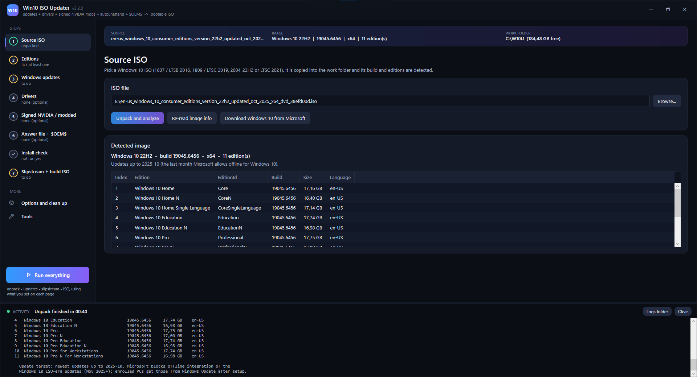
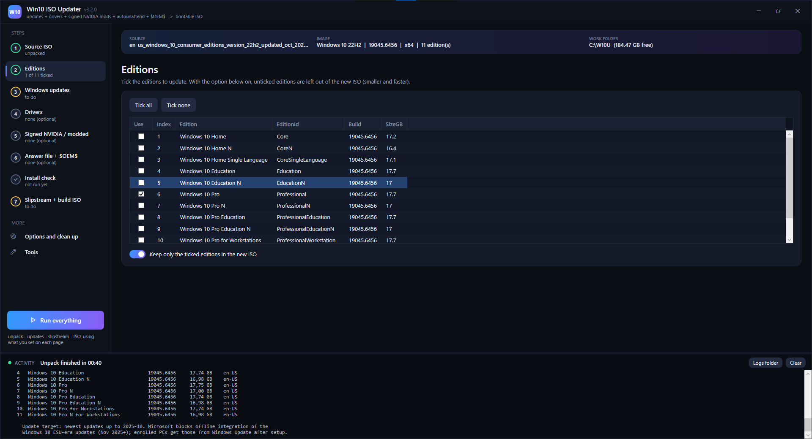
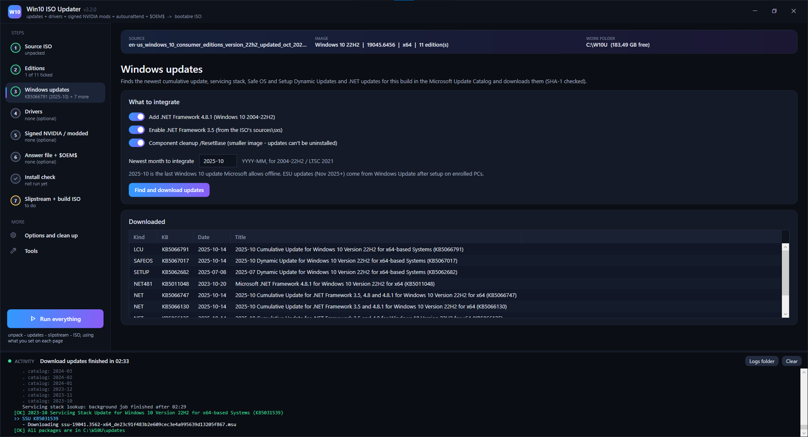
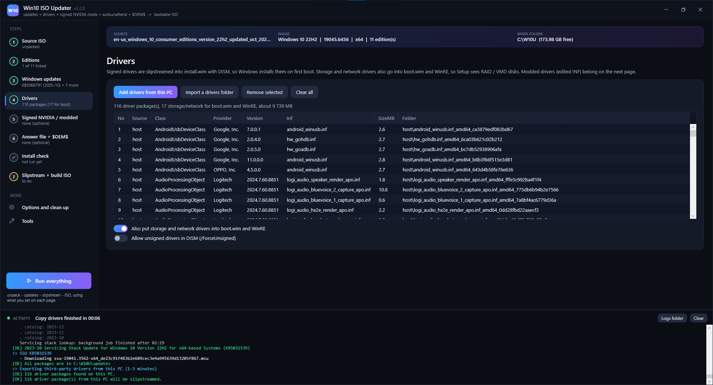
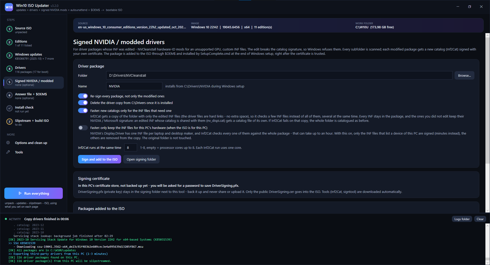
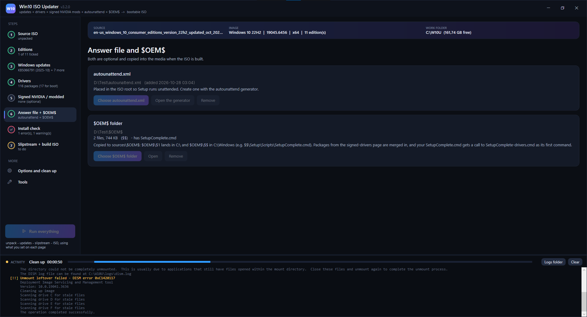
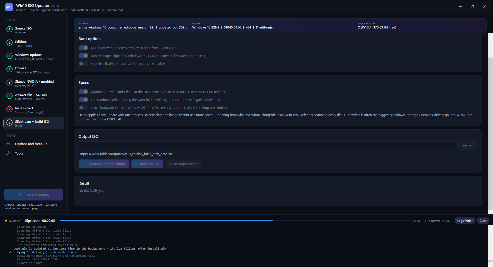

# Windows ISO Updater

   [](https://github.com/j0p3s/Windows-ISO-Updater/actions/workflows/tests.yml)

**One file. Double-click. Get a fully updated Windows 10 or Windows 11 ISO with your drivers, your signed NVIDIA mod, your answer file and your `$OEM$` folder baked in.**

`Windows-ISO-updater-GUI_vX.X.X.cmd` (the version is part of the file name) is a single-file tool with a dark graphical interface that:

1. **Unpacks a Windows 10 or Windows 11 ISO** (pick the version on page 1) and detects its build, editions, language and architecture
2. **Downloads every update it needs** from the Microsoft Update Catalog (cumulative update, servicing stack, Safe OS and Setup Dynamic Updates, .NET)
3. **Slipstreams drivers** from this PC or from a `Drivers-Backup` folder (storage and network drivers also go into `boot.wim` and WinRE)
4. **Re-signs modded drivers** (NVCleanstall hardware-ID mods, edited INF files) with your own certificate and installs them during setup
5. **Adds your `autounattend.xml` and `$OEM$` folder**
6. **Checks everything** before the build: answer file, `$OEM$` scripts and drivers, with one-click fixes
7. **Builds a bootable BIOS + UEFI ISO**

Missing tools (`oscdimg`, `Inf2Cat`, `signtool`) are downloaded automatically from Microsoft and verified.

**Contents:** [Screenshots](#screenshots) · [Quick start](#quick-start) · [The pages](#the-pages) · [Speed](#speed) · [Modded drivers](#modded-drivers-nvidia--nvcleanstall) · [Install check](#install-check) · [Display and accessibility](#display-and-accessibility) · [Supported Windows versions](#supported-windows-versions) · [Privacy](#privacy-what-stays-on-your-pc) · [Files the tool creates](#files-the-tool-creates) · [Troubleshooting](#troubleshooting) · [Building from source](#building-from-source) · [Changelog](#changelog) · [Legal notice](#legal-notice)

---

## Screenshots

<!-- SCREENSHOTS -->

*Page 1: the ISO unpacked and analysed. The Activity panel at the bottom shows the live log of every job.*

| | |
|---|---|
|  |  |
| **2 · Editions:** tick the editions to keep. | **3 · Windows updates:** the October 2025 cumulative update, Safe OS and Setup Dynamic Updates, and .NET, found and downloaded. |
|  |  |
| **4 · Drivers:** 116 packages from this PC, 17 of them also go into boot.wim and WinRE. | **5 · Signed NVIDIA / modded:** a modded package with the faster signing options. |
|  |  |
| **6 · Answer file + $OEM$:** your `autounattend.xml` and `$OEM$` folder, copied into the media when the ISO is built. | **7 · Slipstream + build ISO**, while the slipstream runs: boot and speed options, the progress bar, and boot.wim updated in the background (status line, right). |
<!-- /SCREENSHOTS -->

---

## Quick start

1. Download **`Windows-ISO-updater-GUI_vX.X.X.cmd`** from the [latest release](https://github.com/j0p3s/Windows-ISO-Updater/releases/latest) and put it in a folder of its own, for example `C:\W10U-Tool`.
2. Double-click it and accept the administrator prompt.
3. On page **1**, choose **Windows 10** or **Windows 11** and pick its ISO. Set up the other pages as you like.
4. Press **Run everything**.

That's it. The new ISO lands in `C:\W10U\output` (the work folder can be changed under *Options*).

The console line at start shows the version (`Starting Windows ISO Updater v3.5.1 ...`), then the console hides and the window opens.

**Updating:** download the new `Windows-ISO-updater-GUI_vX.X.X.cmd`, put it in the same folder and delete the old one (the file name changes with every version). Your settings, the `signing` folder and the work folder (unpacked media, updates, drivers) are kept — the tool picks up where you left off.

> Requirements: Windows 10 or 11, Windows PowerShell 5.1 (built in), administrator rights, an NTFS drive with about 30 GB free, and an internet connection. You bring your own Windows 10 or 11 ISO and need a valid Windows license for every PC you install it on — see [Legal notice](#legal-notice).

---

## The pages

| # | Page | What it does |
|---|------|--------------|
| 1 | **Source ISO** | Windows 10 or Windows 11 (the choice follows the ISO you unpack), the download link for it, and unpacking the ISO into the work folder with its build, editions, language and architecture |
| 2 | **Editions** | Tick the editions to update. Unticked ones can be left out, which makes the ISO smaller and the build faster |
| 3 | **Windows updates** | Finds and downloads the newest LCU, SSU, Safe OS DU, Setup DU, .NET 4.8.1 and .NET CU (SHA-1 checked). Optional .NET 3.5 and `/ResetBase` |
| 4 | **Drivers** | *Add drivers from this PC* (`Export-WindowsDriver`) or *Import a drivers folder* (for example `Drivers-Backup` made by `Drivers.cmd`). All subfolders are scanned, and drivers for the wrong architecture are left out |
| 5 | **Signed NVIDIA / modded** | Re-signs edited driver packages so Windows accepts them (see below) |
| 6 | **Answer file + `$OEM$`** | Your `autounattend.xml` (from [autounattended-generator](https://github.com/j0p3s/autounattended-generator)) and your `$OEM$` folder |
| ✓ | **Install check** | Finds what would break or stall a clean install, and fixes it |
| 7 | **Slipstream + build ISO** | Services WinRE, `install.wim` and `boot.wim`, then writes the ISO. Options: no "press any key", Windows UEFI CA 2023 boot manager, split `install.wim` for FAT32, [speed options](#speed), output file name |
| | **Options and clean up** | Work folder, **Clean up** (mounted images, temp files, and on request updates, media, ISOs, signed copies, copied drivers, answer file copy, logs — or **Everything**), defaults |
| | **Tools** | Shows DISM, `oscdimg`, `Inf2Cat`, `signtool` and `curl`, and downloads what is missing |

The **Activity** panel at the bottom shows the live log, a progress bar and what the current job is doing. **Run everything** (left) runs unpack → updates → slipstream → ISO with what you set on each page.

While a job runs, Windows doesn't go to sleep (the screen can still turn off). The taskbar button shows the progress too. If the window is in the background when a job ends or asks a question, the button flashes. It turns red after an error and yellow while a question is waiting.

### Display and accessibility

Two buttons in the **top right corner**, next to minimize:

| Button | What it does |
|---|---|
| **Sun / moon** | Switches between the **dark** and the **light** theme at once |
| **Display and accessibility** (the accessibility icon) | Opens a panel with **Theme** (*Dark*, *Light*, or *Like Windows*, which follows the app mode in Windows' color settings), **Text size** (*100 %*, *115 %*, *130 %*, *150 %* — it enlarges the whole window, text and controls together) and **Font** (*Segoe UI*, *Verdana*, *Tahoma*, *Arial*; Verdana and Tahoma have wider, more distinct letters) |

- **Ctrl + plus**, **Ctrl + minus** and **Ctrl + 0**, or **Ctrl + mouse wheel**, change the text size anywhere in the window. **Esc** closes the panel.
- The choices are saved and used at the next start. The dialogs (driver picker, certificate password) follow them too.
- In the light theme, every text color has at least 4.5:1 contrast on its background (WCAG AA); the tests check it.
- The buttons in the title bar have names for screen readers.

The ISO is written to a temporary `.part` file and renamed when oscdimg has finished, so a failed build never deletes an older ISO of the same name. Before oscdimg starts, the tool checks that the output drive has room for the ISO and that the file isn't mounted or open somewhere.

---

## Speed

DISM applies each update with a single process, so servicing **one** image can't use more cores. What the tool does instead (page 7, *Speed*):

| Option | Default | Effect |
|---|---|---|
| **Update boot.wim and WinRE at the same time as install.wim** | on | Neither depends on `install.wim`. `boot.wim` is serviced in a background worker from the start. WinRE is serviced in a second one as soon as the first edition is mounted, and the edition only waits for it just before it is saved. Their logs follow in the Activity panel, and the status line shows all jobs. Saves the whole `boot.wim` time (often 5–8 minutes) and most of the WinRE time. Off: both are updated one after the other, as before. |
| **Let Windows Defender skip the work folder while a job runs** | off | Real-time scanning of every file DISM, robocopy and oscdimg write is often the biggest slowdown (20–40%). The work folder is excluded only for the job and removed again at the end — and at the next start if the program was closed during a job. An exclusion you set yourself is left alone. |
| **Leave boot.wim index 1 as it is** | off | Index 1 is Windows PE for WDS servers; USB / DVD setup boots index 2. Microsoft updates both, hence off. |

Always on:
- Storage / network drivers go into WinRE and `boot.wim` with **one** DISM call instead of one per driver.
- Servicing uses a scratch folder inside the work folder (`temp\scratch`) instead of `%TEMP%`.
- WinRE is updated once and copied into every edition. If its update fails, it is not tried again for the next edition.
- *Find and download updates*: the lookup for a standalone servicing stack update walks back up to 36 months of the catalog, one search per month, and usually finds nothing. It runs in the background while the other updates are found and downloaded.

The biggest factor is the number of editions: each ticked edition is updated one after the other and adds the full `install.wim` time. Tick only the editions you need on page 2.

Putting the work folder on an NVMe drive (*Options*) helps too.

---

## Modded drivers (NVIDIA / NVCleanstall)

Editing a driver's INF (for example, adding the hardware ID of a GPU that NVIDIA doesn't officially support) breaks its catalog signature. 64-bit Windows then refuses to install it.

On page **5**:

1. Pick the folder NVCleanstall extracted. Every subfolder is scanned.
2. Press **Sign and add to the ISO**. The tool then:
   - copies the package into the work folder (your original is not touched)
   - extracts only `Inf2Cat` + `signtool` from Microsoft's NuGet packages (Windows SDK build tools / Windows Driver Kit) — nothing is installed
   - creates a **self-signed code-signing certificate** the first time (you choose the password for its backup `DriverSigning.pfx`)
   - builds a new catalog **only for the INF files that need one** and signs and verifies it. That covers an edited INF and a catalog signed with a certificate Windows doesn't trust (NVCleanstall signs its packages with its own). The other INF files keep NVIDIA's / Microsoft's catalog.
   - runs several `Inf2Cat` at the same time and signs all new catalogs together
   - shows what `Inf2Cat` is doing, for how long and about how long is left in the status line (the progress bar fills too), and logs how long each folder took
3. When the ISO is built, the package goes to `$OEM$\$1\Drivers\NVIDIA` together with the public `DriverSigning.cer`, and `SetupComplete-drivers.cmd` is generated. During Windows setup that script:
   - trusts the certificate (`Trusted Root` + `Trusted Publishers`)
   - runs `pnputil /add-driver ... /subdirs /install`
   - optionally deletes the driver copy from `C:\Drivers` (turn this off if a script of yours still needs the files, for example `C:\Drivers\NVIDIA\setup.exe`; the Install check spots that)
   - runs only once, even when it is also started from the answer file's `specialize` pass (see Install check)

If your `$OEM$` already has a `SetupComplete.cmd`, a `call "%~dp0SetupComplete-drivers.cmd"` line is added to the copy that goes into the ISO. Your own file is not changed.

### Why signing NVIDIA takes so long, and what makes it faster

NVIDIA's `Display.Driver` folder has one INF file per laptop and desktop maker (about 40), all pointing at the same ~1 GB of files. `Inf2Cat` checks every INF it is given against the whole package, so cataloguing a full NVIDIA folder can take **up to an hour**. The status line keeps counting while it works; `engine.log` gets a "still running" line every 5 minutes.

The speed-ups come from [NVIDIA Modded Drivers Signer](https://github.com/j0p3s/nvidia-modded-drivers-signer) 1.1–1.5 (page 5):

| Option | Default | Effect |
|---|---|---|
| **Faster: new catalogs only for the INF files that need one** | on | Usually NVCleanstall edits one or a few INF files. `Inf2Cat` gets a copy of the folder with only those INF files, so it checks a few INF files instead of 40. The driver files in that copy are hard links (no time, no extra space; copied on drives without hard links). The other INF files keep their NVIDIA / Microsoft catalog and signature, and every INF stays in the package, so the driver still installs on any hardware. NVIDIA's INF files share one catalog (`nv_dispi.cat`): an edited INF then gets a catalog file of its own (`nv_dispi_w10u.cat`, only its `CatalogFile=` line changes in the work copy), so the shared catalog stays valid for the others. If `Inf2Cat` fails on the copy, the whole folder is catalogued as before. Off: every INF in a folder that needs signing gets a new catalog. |
| **Inf2Cat runs at the same time** | processor cores, up to 8 | One `Inf2Cat` uses one core. Folders (and the INF files within a folder that need a new catalog) are catalogued side by side, 1–8 at a time. |
| **Only keep the INF files for this PC's hardware** | off | Removes the INF files for other hardware from the work copy (details below). Use it when every INF needs a new catalog and the ISO is for this PC. |

Always on: all new catalogs are signed together (up to 16 per `signtool` call), and the time estimate learns how fast `Inf2Cat` is on this PC (`tools\inf2cat-speed.json`).

**Faster: only keep the INF files for this PC's hardware** (page 5, off by default) reads the hardware IDs of this PC and, in folders with several INF files, keeps only the ones that list a device of this PC — for example the INF you added your GPU's ID to with NVCleanstall. The others are removed from the work copy (the original folder is not touched), so signing takes minutes.
- INF files without device IDs, and INF files that a kept one includes (`Include=`), stay.
- A folder where no INF matches this PC is kept whole.
- Use it only when the ISO is for **this PC**: the driver then installs only on matching hardware.
- NVIDIA's own `setup.exe` may refuse to run from a trimmed copy; `pnputil` installs the driver anyway. The Install check warns when a script of yours runs that `setup.exe`.

The kernel driver files keep NVIDIA's own signature. Only the catalog is yours, so **Secure Boot can stay on**.

> ⚠️ **Keep `signing\DriverSigning.pfx` private and backed up.** Anyone with it can sign drivers that your PCs will trust. Only the public `.cer` goes into the ISO. It is excluded by [`.gitignore`](.gitignore) — never upload it.

> ℹ️ The NVIDIA Control Panel in DCH drivers is a separate Store app and is not installed this way.

---

## Install check

The **Install check** page (it also runs automatically before every build) compares your answer file, `$OEM$` folder and drivers with the ISO that is being built.

**Answer file (`autounattend.xml`)**
- wrong `processorArchitecture` (Setup silently ignores those components) → **fix**
- edition index that changed because only some editions were kept → **fix**
- edition name or generic product key that isn't in the ISO
- setup / display language that isn't in the ISO → **fix**
- invalid computer name (more than 15 characters, `_`, only digits) → **fix** (`*`)
- time zone that doesn't exist → **fix** (this PC's)
- reserved or invalid account names, account equal to the computer name, hidden account screen with no account
- duplicate or missing `<Order>` numbers → **fix**
- `Extend` + `Size` on the same partition → **fix**, `InstallTo` + `InstallToAvailablePartition` → **fix**
- disk wipe warning, GPT/UEFI vs MBR/legacy boot hint, EFI partition size
- commands that use files missing from `$OEM$` or fixed drive letters (`D:\`)
- scripts the answer file writes itself (`<Extensions><File path="...">`, as made by the autounattend generator) count as existing, and their PowerShell is checked too

**`$OEM$` folder**
- folders that Windows Setup ignores (anything other than `$$` and `$1`)
- `autounattend.xml` inside `$1` (never read by Setup) → **fix**: use it as the answer file
- `unattend.xml` in `$$\Panther`, `SetupComplete.cmd` in the wrong place
- scripts saved as UTF-16 / with a BOM / with LF line endings
- `pause`, `set /p`, `choice` or restarts in scripts that run hidden during setup (one finding per script, with line numbers). A script called with parameters (`call "%~dp0Tool.cmd" /switch`) is treated as running unattended, so its menus are only noted
- files a script uses that won't exist — Windows' own folders (`System32`, `Sysnative`, `Panther`, `Temp`, `Program Files`, ...) and paths built from variables are not reported
- driver folders whose INF was edited, is unsigned or is signed with an untrusted certificate (Windows will refuse them)
- driver folders that nothing installs → **fix**: install them with `pnputil`

**Drivers and setup scripts**
- slipstreamed drivers that are not validly signed (for example, a modded NVIDIA driver exported from this PC) → **fix**: remove them
- signed packages made with a different certificate or missing from the work folder
- packages signed with *only the INF files for this PC* (noted), and a script that runs their `setup.exe` (warning)
- something that uses a file inside a signed package while the driver copy is deleted after installation → **fix**: keep the copy
- **SetupComplete.cmd is skipped by Windows on Home/Pro installs activated with an OEM key** (PCs sold with Windows keep the key in the firmware; the tool checks this PC too) → **fix**: the driver script also runs from the `specialize` pass of the answer file, and runs only once

Fixes only change the copies that go into the ISO. You can **save the fixed answer file** over your own, or **undo** the answer file fixes.

---

## Supported Windows versions

Pick **Windows 10** or **Windows 11** on page 1. That choice sets the download link and the hints. When you unpack an ISO, it switches to the Windows that ISO really is.

| Windows | Versions with automatic updates | Notes |
|---|---|---|
| **Windows 10** | 1607 / LTSB 2016, 1809 / LTSC 2019, 2004–22H2, LTSC 2021 (x64, x86, ARM64) | 2004–21H2 get the 22H2 enablement package. ESU limit, see below. |
| **Windows 11** | 21H2, 22H2 / 23H2, 24H2 / LTSC 2024, 25H2 (x64, ARM64) | 22H2 gets the 23H2 enablement package. 21H2 is out of servicing and gets its last updates (2024-10). |

Any other image can still get drivers, signed packages, an answer file and `$OEM$`.

**Windows 10 and ESU:** Microsoft blocks offline integration of the Windows 10 **ESU** updates (November 2025 and later). For 2004–22H2 and LTSC 2021 the default limit is **2025-10** (KB5066791, build 19045.6456). PCs enrolled in ESU get the newer updates from Windows Update after setup. The month can be changed on page 3.

**Windows 11:**
- The newest updates in the catalog are used. The cumulative update includes the servicing stack, so the standalone servicing stack lookup is skipped. .NET 4.8.1 is built in.
- From 24H2 on, a cumulative update's catalog entry also holds the *checkpoint* update it builds on. Both are downloaded, and the checkpoint goes in first.
- **On a Windows 10 PC**, the slipstream needs a newer DISM, because Windows supports servicing an image only with a DISM of the same or a newer Windows. The tool then offers to install the **Windows ADK Deployment Tools** from Microsoft, signature-checked, and uses their DISM for that image. This PC's own DISM is not changed. On a Windows 11 PC, its own DISM is used.
- The tool doesn't change Windows 11's hardware requirements (TPM 2.0, Secure Boot, supported CPU). Setup checks them as usual.

---

## Privacy: what stays on your PC

The tool talks only to Microsoft (Update Catalog, download servers, symbol server, nuget.org for the signing tools). It sends nothing about you or your PC anywhere.

What is private — **never share or upload it:**

| What | Why |
|---|---|
| `signing\DriverSigning.pfx` | Your signing key. Anyone with it can make drivers your PCs trust. |
| The ISO / USB stick you build | It contains your `autounattend.xml` — account password and Wi‑Fi key in plain text — and your `$OEM$` folder. The Install check reminds you. |
| The work folder (`C:\W10U`) | Copies of the above, your drivers and the logs (they show your paths and user name). |

The repository's [`.gitignore`](.gitignore) excludes all of that, so a fork or pull request can't pick it up by accident. Before posting a log in an issue, look through it for names and paths you'd rather not show.

---

## Files the tool creates

| Path | Contents |
|------|----------|
| `tools\` (next to the .cmd) | Downloaded `oscdimg`, `Inf2Cat`, `signtool` — safe to delete |
| `signing\` (next to the .cmd) | `DriverSigning.pfx` (**private**) + `DriverSigning.cer` |
| `Windows-ISO-Updater.settings.json` | Your options (the same file for every version; `Win10-ISO-Updater.settings.json` from 3.3 and older is read once) |
| `C:\W10U\` (work folder) | Unpacked media, updates, drivers, signed copies, logs, `state.json`, output ISO — all removed by *Clean up → Everything* |

Logs: `C:\W10U\logs\engine.log` and `dism.log` (`dism-boot.log` for boot.wim when it runs in the background). During install, the driver script writes `C:\Windows\Temp\SetupComplete-drivers.log`.

---

## Troubleshooting

| Problem | Fix |
|---------|-----|
| "Mount folder is not empty" | *Options and clean up* → **Clean up now** |
| Start completely fresh | *Options and clean up* → tick **Everything** → **Clean up now** (settings and the signing certificate are kept) |
| Cumulative update fails with an ESU-related error | Set the month on page 3 back to `2025-10` |
| Drivers didn't install after setup | Read `C:\Windows\Temp\SetupComplete-drivers.log`, and run the **Install check** (OEM-key fallback) |
| `Inf2Cat` "Signability test failed" | Delete `inf2cat.exe.manifest` next to `Inf2Cat.exe` and sign again |
| Windows 11 slipstream fails on a Windows 10 PC | Answer **Yes** when the tool offers the Windows ADK Deployment Tools (this PC's DISM is too old for Windows 11), or install them yourself and run the slipstream again |
| *Re-sign drivers* runs for a very long time on `Display.Driver` | Normal when every INF of a full NVIDIA package needs a new catalog (up to an hour) — the log says how many INF files get one and how long it should take. Check that `Inf2Cat.exe` uses CPU in Task Manager → Details. Faster: keep *New catalogs only for the INF files that need one* on, raise *Inf2Cat runs at the same time*, or turn on *Only keep the INF files for this PC's hardware* |
| Signing: "Inf2Cat failed on the isolated INF file(s) - the whole folder is catalogued instead" | Inf2Cat rejected the copy with only the edited INF files; the tool then signs the whole folder, as before. Nothing to do, but please open an issue with `logs\engine.log` |
| "Could not start: The property 'ItemsSource' cannot be found" / "SignTool Error: ... terminated in a root" / check list shows `System.Object[]` | Bugs of v2.0.0 – v2.0.3. Make sure the copy you start is the newest: the first console line shows the version |
| A line starting with `Interface error:` in the Activity log | Something in the window failed but the program kept running — please open an issue with that line and `C:\W10U\logs\engine.log` |
| The full Windows SDK / WDK got installed (v2.0.0) | Not needed any more — uninstall *Windows Software Development Kit* and *Windows Driver Kit* under Settings → Apps if you like |
| Build ISO: "The path is not of a legal form" (v2.0.6 and older) | The *Output ISO* box had a name without a folder — update, or clear the box |
| ISO won't boot with Secure Boot on (Boot2023 option) | The firmware doesn't trust *Windows UEFI CA 2023* yet — turn the option off or update the firmware's Secure Boot DB |
| install.wim larger than 4 GB for a FAT32 USB | Use Rufus, or turn on *Split install.wim* on page 7 |
| Build ISO: "Not enough free space for the ISO" | Free space on that drive, or put a folder on another drive in *Output ISO* (page 7) |
| Build ISO: "... is in use - it is probably mounted in Explorer" | Eject the ISO's drive in Explorer (or close the virtual machine using it), or choose another name |

---

## Building from source

The `.cmd` is assembled from the files in [`src/`](src):

```
python src/build.py
```

`src/engine_v1.ps1` is the original engine (catalog, DISM servicing, ISO build). `build.py` takes the parts it needs from it and adds the GUI, signing and install check parts. The output is ASCII with CRLF line endings, which `cmd.exe` requires.

| File | Part |
|------|------|
| `00_header.cmd` | batch launcher: elevation, starts the PowerShell part of the same file |
| `10_engine_head.ps1` | constants, log sink (every `Write-Host` goes to the Activity panel), Yes/No questions from the worker |
| `30_engine_tools.ps1` | console tools with live output and progress, several Inf2Cat runs at the same time, oscdimg / Inf2Cat / signtool download |
| `35_engine_service.ps1` | slipstream: WinRE, install.wim, boot.wim (optionally in a background runspace), media update |
| `36_engine_build.ps1` | ISO build: free space and "in use" checks, oscdimg into a `.part` file, SHA-256 |
| `37_engine_download.ps1` | finds and downloads the updates (servicing stack lookup in a background job) |
| `38_engine_windows.ps1` | Windows 10 / 11 detection, catalog title patterns, update order (24H2 checkpoints), the DISM for the image (ADK on a Windows 10 PC), Analyze |
| `31_engine_sign.ps1` | certificate, catalogs, re-signing (isolated copies with only the INF files that need a new catalog), `$OEM$` assembly, `SetupComplete-drivers.cmd` |
| `33_engine_check.ps1`, `34_engine_check2.ps1` | install check and its fixes |
| `32_engine_jobs.ps1` | driver scan / import, answer file, run everything, job entry point for the background worker |
| `40_gui_xaml.ps1`, `45_gui_dialogs.ps1` | window, pages and dialogs (WPF XAML) |
| `50_gui.ps1`, `55_gui_main.ps1` | window logic, background worker, events |

### Tests

```
pwsh tests/run-tests.ps1
```

Twelve suites (about 375 checks) run the PowerShell part on Linux / macOS with PowerShell 7: catalog parsing (Windows 10 and Windows 11 titles, the 24H2 checkpoint order, the DISM choice), signing with stand-ins for `signtool` / `Inf2Cat` (an NVCleanstall-style untrusted catalog, live Inf2Cat status from a worker runspace, keeping only this PC's INF files, isolated copies with only the edited INF files, an own catalog for an INF whose catalog is shared (NVIDIA's `nv_dispi.cat`) with its encoding kept, several Inf2Cat runs at the same time, the fallback to the whole folder, batched signing, the time estimate), `$OEM$` assembly, every install check finding and fix, an answer file made by the autounattend generator (`tests/fixtures`, personal data removed), the page refresh with Windows PowerShell 5.1's JSON behaviour simulated (and the taskbar progress), the dark / light theme (XAML conversion, a light color for every color, text contrast) with the text size and font settings, a whole slipstream against a stand-in `dism` (boot.wim and WinRE in the background vs. sequential, a failed WinRE update, the driver set, the Defender option), the ISO build against a stand-in `oscdimg` (failed build, ISO in use, free space), and the download step with a stand-in catalog (the servicing stack lookup running while the other updates download). DISM, WPF and real driver installs still need a Windows test run.

---

## Changelog

The full list of changes is in **[CHANGELOG.md](CHANGELOG.md)**; every release on the [Releases](https://github.com/j0p3s/Windows-ISO-Updater/releases) page carries its own part of it.

| Version | Date | Highlights |
|---|---|---|
| **3.5.1** | 2026-10-30 | Fix: 3.5.0 didn't open on Windows (*"'#FF0B0E14' is not a valid value for property 'Background'"*) |
| 3.5.0 | 2026-10-29 | Dark / light theme, text size and font (top right corner), keyboard zoom, screen-reader names |
| 3.4.0 | 2026-10-28 | Renamed to **Windows ISO Updater**; the file carries its version: `Windows-ISO-updater-GUI_vX.X.X.cmd`; code-review fixes |
| 3.3.0 | 2026-10-28 | Windows 11 support and a Windows 10 / 11 switch on page 1 |
| 3.2.0 | 2026-10-28 | Faster NVIDIA signing: new catalogs only for the INF files that need one |
| 3.1.0 | 2026-10-28 | Faster driver signing (speed-ups from NVIDIA Modded Drivers Signer 1.1–1.4) |
| 3.0.0 | 2026-10-27 | Faster slipstream and downloads, PC kept awake, taskbar progress, safer ISO build |
| 2.1.x | 2026-10-25 | boot.wim updated in parallel, Defender option, *Clean up → Everything*, readable text |
| 2.0.x | 2026-10-24 | Single file with a graphical interface, signed NVIDIA mods, `$OEM$`, Install check with fixes, live Inf2Cat status |
| 1.x | — | Console menu: unpack, updates, drivers, answer file, ISO build |

---

## Contributing

Bug reports and ideas are welcome — see [CONTRIBUTING.md](CONTRIBUTING.md). Security problems: [SECURITY.md](SECURITY.md). By sending a pull request you agree that your contribution is published under this project's [MIT license](LICENSE).

---

## Related

- [autounattended-generator](https://github.com/j0p3s/autounattended-generator) — make the `autounattend.xml`
- [Update-SecureBootCert](https://github.com/j0p3s/Update-SecureBootCert) — Secure Boot certificate updater
- [Build-exe_from_bat_cmd_or_ps1](https://github.com/j0p3s/Build-exe_from_bat_cmd_or_ps1) — turn this .cmd into an .exe

---

## Legal notice

This notice is not legal advice. If you plan to use the tool in a business, or to hand ISOs or drivers made with it to anyone else, check the license terms below (or ask a lawyer) first.

### Independent project, trademarks

Windows ISO Updater is an independent, unofficial project. It is **not made, endorsed, sponsored or supported by Microsoft, NVIDIA or TechPowerUp** (the maker of NVCleanstall), and none of them is responsible for it.

Microsoft, Windows, Windows PE, DISM, Microsoft Defender (Windows Defender) and Windows Update are trademarks of the Microsoft group of companies. NVIDIA is a trademark or registered trademark of NVIDIA Corporation in the U.S. and other countries. NVCleanstall is a product of TechPowerUp. Other product and company names are trademarks of their respective owners. They are used here only to say which products the tool works with.

### Windows is not included — you need your own license

- The tool contains **no Windows files, no product keys and no activation workaround**, and it doesn't change licensing or activation. You supply the Windows 10 or 11 ISO yourself (for example from Microsoft's download pages for [Windows 10](https://www.microsoft.com/software-download/windows10ISO) and [Windows 11](https://www.microsoft.com/software-download/windows11)).
- Every PC you install Windows on with the ISO needs a **valid Windows license**. Installing from an updated ISO doesn't change that.
- **ESU:** the tool doesn't integrate Windows 10 Extended Security Updates (November 2025 and later) and doesn't get around ESU enrolment. Enrolled PCs get those updates from Windows Update.

### Microsoft updates and tools

- Updates come from the Microsoft Update Catalog. `oscdimg.exe` comes from the Microsoft symbol server. If that fails, the tool installs the Windows ADK *Deployment Tools* from Microsoft. It also offers those tools when a Windows 11 image is serviced on a Windows 10 PC, to use their DISM. `signtool` and `Inf2Cat` come from Microsoft's NuGet packages (`Microsoft.Windows.SDK.BuildTools`, `Microsoft.Windows.WDK.x64`).
- The tool downloads them **straight from Microsoft to your PC** when a step needs them (or uses copies already on the PC). **This repository does not contain or redistribute any of them.**
- They stay Microsoft's software under Microsoft's license terms: the Windows license terms for updates, the Windows ADK terms for `oscdimg` and the ADK's DISM, and the Windows SDK / Windows Driver Kit terms for `signtool` and `Inf2Cat`. You are responsible for following them.
- The SDK and WDK packages are meant for developing and testing software. Check that your use is allowed under their terms.

### The ISO you build: for your own use

- The ISO contains Microsoft's software and any drivers you added. **Uploading, selling or otherwise passing it on** can break Microsoft's license terms, the drivers' licenses and copyright law. Build it for PCs you are licensed to install it on.
- It also contains your answer file, which usually holds a password and a Wi‑Fi key (see [Privacy](#privacy-what-stays-on-your-pc)). That is one more reason not to share it.

### Drivers and NVIDIA / NVCleanstall packages

- Drivers you slipstream or re-sign belong to their vendors and are covered by their licenses, for example the NVIDIA software license agreement. Editing a driver's INF file, re-signing it, or giving a modified package to someone else may not be allowed under that license. **Check before you do it**, above all before sharing a modified package.
- The tool doesn't change any driver binary (`.sys`, `.dll`). In its own work copy of the package, it does three things:
  - writes new catalog files;
  - signs them with your certificate;
  - for an INF whose catalog is shared with other INF files, changes the `CatalogFile=` line.

  Your original folder is not touched.
- Re-signed packages carry **your self-signed certificate, not a signature from Microsoft (WHQL) or the vendor**.
  - The vendor is not responsible for a modified driver and may not support it.
  - Every PC set up from the ISO trusts your certificate (Trusted Root and Trusted Publishers). Keep `DriverSigning.pfx` private ([SECURITY.md](SECURITY.md)).
- The tool doesn't turn off driver signature enforcement or Secure Boot.

### No warranty

The software is provided **"as is", without warranty of any kind**, under the [MIT license](LICENSE). The authors are not liable for any damage or loss from using it, including:

- lost data (an answer file can wipe disks);
- PCs that don't boot or install;
- driver problems;
- use that breaks a license.

Read the Install check findings before booting an ISO on a PC with data you care about. Back up first, and try a new ISO in a virtual machine or on a spare PC.

### Privacy

The tool sends no telemetry and nothing about you or your PC. Its only network requests go to Microsoft's servers (Update Catalog and download servers, symbol server) and to nuget.org, to download the files above. Those services' own privacy policies apply to those requests. Two buttons, *Download Windows 10 from Microsoft* and *Open the generator*, open a web page in your browser. Details: [Privacy](#privacy-what-stays-on-your-pc).

## License

This project's own code and documentation are under the [MIT license](LICENSE). The license doesn't cover Windows, Microsoft's updates and tools, or the drivers the tool works with. Those keep their own license terms (see above).

The signing speed-ups come from [NVIDIA Modded Drivers Signer](https://github.com/j0p3s/nvidia-modded-drivers-signer), by the same author and also under MIT.
